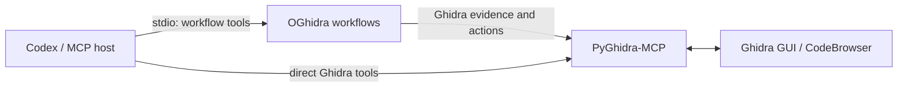

# OGhidra — AI-powered reverse engineering with Ghidra

OGhidra connects language models to a live Ghidra session through MCP. It adds
repeatable DSPy workflows to the inspection and editing tools exposed by
[PyGhidra-MCP](https://github.com/clearbluejar/pyghidra-mcp).

`rename_current_function` is the packaged workflow: it gathers evidence about
the function selected in Ghidra, proposes a descriptive name, and can apply the
rename after revalidating the target.

## Quick start

This path uses the Bash helpers on Linux or macOS. Windows users can follow the
[manual PowerShell commands](#windows-powershell) below.

### Prerequisites

- Python 3.12 or later.
- [Ghidra](https://ghidra-sre.org/) and the JDK required by that Ghidra release.
- [Codex CLI or another local Codex client](https://developers.openai.com/codex/mcp/).
- Access to a hosted model API, Ollama, or a vLLM-compatible endpoint.

OGhidra does not install Ghidra, a JDK, or a model.

### 1. Clone and set up

```bash
git clone https://github.com/llnl/OGhidra.git
cd OGhidra
./scripts/setup.sh --register-codex
```

The setup script creates two intentionally separate environments:

- `.venv-ghidra` contains PyGhidra-MCP and its Ghidra/JVM dependencies.
- `.venv` contains the OGhidra workflow server.

It also creates `config.yaml` from the example when that file is missing. It
never overwrites an existing configuration. With `--register-codex`, it adds
the `pyghidra` and `oghidra` MCP servers; registrations that already exist are
reported and left unchanged. Omit the flag if you use another MCP host or want
to register Codex manually.

### 2. Configure the model

Edit the `lm` section of `config.yaml` and replace
`replace/provider-and-model-id`. Build the value as:

```text
<LiteLLM integration>/<exact endpoint model ID>
```

For example, use `openai/gpt-4o` for the literal OpenAI model ID `gpt-4o`, or
`ollama_chat/llama3.2` with `api_base: http://127.0.0.1:11434` for a local
Ollama model. Preserve any slashes that are part of the endpoint's exact model
ID.

If authentication is required, set `api_key_env` to an environment-variable
name and expose that variable to the Codex process. Never put the secret itself
in `config.yaml`. See [Model and host setup](docs/model-and-host-setup.md) for
provider examples, model-ID details, and non-Codex MCP hosts.

### 3. Start Ghidra and PyGhidra-MCP

In terminal 1, provide your Ghidra installation and the native PyGhidra-MCP
arguments for a new project and program:

```bash
export GHIDRA_INSTALL_DIR=/absolute/path/to/ghidra
./scripts/run-ghidra.sh \
  --project-path /absolute/path/to/projects \
  --project-name research \
  /absolute/path/to/program
```

For an existing project, omit the binary and pass its `.gpr` file:

```bash
export GHIDRA_INSTALL_DIR=/absolute/path/to/ghidra
./scripts/run-ghidra.sh --project-path /absolute/path/to/project.gpr
```

The run script launches PyGhidra-MCP and the Ghidra GUI on the required local
MCP endpoint. It does not launch Codex, doctor, or a workflow. Codex launches
the separate OGhidra stdio server when a client session starts.

Keep terminal 1 and the Ghidra GUI open. In CodeBrowser, wait for analysis to
finish and place the cursor inside the target function.

### 4. Check the session

In terminal 2, run the read-only doctor:

```bash
.venv/bin/oghidra-doctor --config config.yaml
```

Doctor validates local configuration, credentials, MCP connectivity, required
tools, and the current Ghidra selection. It does not contact the model,
decompile code, or modify Ghidra. A ready session reports `PASS` for the Ghidra
selection; model connectivity remains a documented `WARN` until a workflow is
invoked.

### 5. Request a rename proposal

Start a new Codex session after registering or changing MCP configuration. Use
`/mcp` to confirm that `pyghidra` and `oghidra` are active, then ask:

```text
Use the oghidra MCP server's rename_current_function tool with apply set to
false for the function currently selected in Ghidra.
```

The result should include:

```text
status: proposed
```

`apply: false` never writes. If `apply` is omitted, the tool defaults to `true`
and may rename the selected function. To apply a rename deliberately, request
`apply: true`; OGhidra performs a fresh analysis and revalidates the live target
before writing. Save the program in Ghidra when finished.

## Manual setup and launch

These commands perform the same setup and launch steps without the Bash
helpers.

### Linux and macOS

Clone the repository, create both environments, and initialize the
configuration:

```bash
git clone https://github.com/llnl/OGhidra.git
cd OGhidra
OGHIDRA_ROOT="$(pwd -P)"

python3.12 -m venv .venv-ghidra
.venv-ghidra/bin/python -m pip install "pyghidra-mcp==0.2.7"

python3.12 -m venv .venv
.venv/bin/python -m pip install -e .
test -e config.yaml || cp config.example.yaml config.yaml
```

After editing `config.yaml`, register both MCP servers:

```bash
OGHIDRA_ROOT="$(pwd -P)"
codex mcp add pyghidra --url http://127.0.0.1:8001/mcp
codex mcp add oghidra -- \
  "$OGHIDRA_ROOT/.venv/bin/oghidra-workflows" \
  --config "$OGHIDRA_ROOT/config.yaml"
codex mcp list
```

Launch a new project and program in terminal 1:

```bash
export GHIDRA_INSTALL_DIR=/absolute/path/to/ghidra
.venv-ghidra/bin/pyghidra-mcp \
  --gui --transport streamable-http --host 127.0.0.1 --port 8001 \
  --project-path /absolute/path/to/projects --project-name research \
  /absolute/path/to/program
```

Or launch an existing project:

```bash
export GHIDRA_INSTALL_DIR=/absolute/path/to/ghidra
.venv-ghidra/bin/pyghidra-mcp \
  --gui --transport streamable-http --host 127.0.0.1 --port 8001 \
  --project-path /absolute/path/to/project.gpr
```

Then run doctor in terminal 2:

```bash
.venv/bin/oghidra-doctor --config config.yaml
```

### Windows PowerShell

Clone the repository, create both environments, and initialize the
configuration:

```powershell
git clone https://github.com/llnl/OGhidra.git
Set-Location OGhidra
$OghidraRoot = (Resolve-Path .).Path

py -3.12 -m venv .venv-ghidra
.\.venv-ghidra\Scripts\python.exe -m pip install 'pyghidra-mcp==0.2.7'

py -3.12 -m venv .venv
.\.venv\Scripts\python.exe -m pip install -e .
if (-not (Test-Path config.yaml)) {
  Copy-Item config.example.yaml config.yaml
}
```

After editing `config.yaml`, register both MCP servers:

```powershell
$OghidraRoot = (Resolve-Path .).Path
codex mcp add pyghidra --url http://127.0.0.1:8001/mcp
codex mcp add oghidra -- `
  "$OghidraRoot\.venv\Scripts\oghidra-workflows.exe" `
  --config "$OghidraRoot\config.yaml"
codex mcp list
```

Launch a new project and program in terminal 1:

```powershell
$env:GHIDRA_INSTALL_DIR = 'C:\absolute\path\to\ghidra'
.\.venv-ghidra\Scripts\pyghidra-mcp.exe --gui --transport streamable-http --host 127.0.0.1 --port 8001 --project-path 'C:\absolute\path\to\projects' --project-name research 'C:\absolute\path\to\program.exe'
```

Or launch an existing project:

```powershell
$env:GHIDRA_INSTALL_DIR = 'C:\absolute\path\to\ghidra'
.\.venv-ghidra\Scripts\pyghidra-mcp.exe --gui --transport streamable-http --host 127.0.0.1 --port 8001 --project-path 'C:\absolute\path\to\project.gpr'
```

Then run doctor in terminal 2:

```powershell
.\.venv\Scripts\oghidra-doctor.exe --config config.yaml
```

Codex CLI, the IDE extension, and the ChatGPT desktop app share the same local
Codex MCP configuration. Start a new Codex session after changing it.

## Troubleshooting first run

| Observation | Meaning and next action |
| --- | --- |
| Doctor cannot connect to `http://127.0.0.1:8001/mcp` | Start PyGhidra-MCP in terminal 1 and keep it running. |
| Doctor reports a missing model placeholder or credential | Finish the `lm` section and expose the named credential to the Codex process. |
| Doctor cannot find a function | Open a program in CodeBrowser and place the cursor inside a function. |
| `/mcp` does not show both servers | Check `codex mcp list`, verify the captured repository path, and start a new Codex session. |
| No `logs/oghidra-*.jsonl` appears | The host did not launch the OGhidra stdio process; recheck registration paths. |
| `/rename_current_function` is unknown | It is an MCP tool, not a slash command. Request it in normal language. |

See [Operations and diagnostics](docs/operations.md) for logs, failure modes,
and workflow safety details.

## Architecture



Both MCP servers are passive. PyGhidra-MCP owns the Ghidra process and GUI;
OGhidra adds higher-level workflows. Opening a project or program does not run
a workflow automatically.

## Development and license

See [Development](docs/development.md) for tests, optional UV usage,
configuration extension points, and repository scope.

The workflow derives from the supplied OGhidra archive's GUI rename workflow
and typed `AnalyzeFunction` signature. [`LICENSE`](LICENSE) is retained from
that archive, including its commercial-use terms. No upstream backend source
is bundled.
