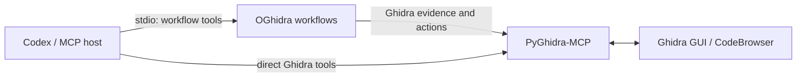

# OGhidra — AI-powered reverse engineering with Ghidra

OGhidra connects language models to a live Ghidra session through MCP. It adds
repeatable DSPy workflows to the inspection and editing tools exposed by
[PyGhidra-MCP](https://github.com/clearbluejar/pyghidra-mcp).

`rename_current_function` is the packaged workflow: it gathers evidence about
the function selected in Ghidra, proposes a descriptive name, and can apply the
rename after revalidating the target.

## Get a rename proposal

This path keeps the first run non-destructive. Commands are shown for a source
checkout on Linux or macOS, with PowerShell equivalents where they differ.

### Prerequisites

- Python 3.12 or later.
- [Ghidra](https://ghidra-sre.org/) and the JDK required by that Ghidra release.
- [Codex CLI or another local Codex client](https://developers.openai.com/codex/mcp/).
- Access to a hosted model API, Ollama, or a vLLM-compatible endpoint.

OGhidra does not install Ghidra, a JDK, or a model. PyGhidra-MCP runs Ghidra in
a separate Python environment; OGhidra connects to that process over MCP.

### 1. Clone and install

```bash
git clone https://github.com/llnl/OGhidra.git
cd OGhidra
OGHIDRA_ROOT="$(pwd -P)"

python3.12 -m venv .venv-ghidra
.venv-ghidra/bin/python -m pip install "pyghidra-mcp==0.2.7"

python3.12 -m venv .venv
.venv/bin/python -m pip install -e .
cp config.example.yaml config.yaml
```

<details>
<summary>Windows PowerShell</summary>

```powershell
git clone https://github.com/llnl/OGhidra.git
Set-Location OGhidra
$OghidraRoot = (Resolve-Path .).Path

py -3.12 -m venv .venv-ghidra
.\.venv-ghidra\Scripts\python.exe -m pip install 'pyghidra-mcp==0.2.7'

py -3.12 -m venv .venv
.\.venv\Scripts\python.exe -m pip install -e .
Copy-Item config.example.yaml config.yaml
```

</details>

The normal workflow environment intentionally does not contain PyGhidra,
JPype, or Ghidra's indexing dependencies.

### 2. Choose a model connection

Edit the `lm` section of `config.yaml` and replace
`replace/provider-and-model-id`. Choose whichever endpoint you already use;
none is the project default.

Construct `lm.model` by prepending one LiteLLM integration name to the exact,
literal model ID reported by the endpoint:

```text
lm.model = <LiteLLM integration> + "/" + <exact endpoint model ID>
```

Only the first slash separates the integration from the model ID. Preserve any
slashes already present in that ID. For example, if `/models` reports the
literal ID `openai/gpt-oss-120b`:

- hosted vLLM uses `hosted_vllm/openai/gpt-oss-120b`;
- a generic OpenAI-compatible API uses `openai/openai/gpt-oss-120b`.

`openai/gpt-oss-120b` instead means “use the `openai` integration with the
literal endpoint ID `gpt-oss-120b`.” It is correct only when the endpoint
actually reports `gpt-oss-120b` without the leading `openai/`.

Hosted API:

```yaml
lm:
  model: openai/EXACT_MODEL_ID  # or anthropic/EXACT_MODEL_ID
  api_key_env: OPENAI_API_KEY  # or ANTHROPIC_API_KEY
  ssl_verify: true
  cache: false
  max_tokens: 4096
```

Ollama:

```yaml
lm:
  model: ollama_chat/EXACT_MODEL_ID
  api_base: http://127.0.0.1:11434
  ssl_verify: true
  cache: false
  max_tokens: 4096
```

Hosted vLLM:

```yaml
lm:
  # This example assumes /models reports "openai/gpt-oss-120b".
  model: hosted_vllm/openai/gpt-oss-120b
  api_base: http://127.0.0.1:8000/v1
  ssl_verify: true
  cache: false
  max_tokens: 4096
```

Generic OpenAI-compatible API:

```yaml
lm:
  # This example assumes /models reports "openai/gpt-oss-120b".
  model: openai/openai/gpt-oss-120b
  api_base: http://127.0.0.1:8000/v1
  ssl_verify: true
  cache: false
  max_tokens: 4096
```

If authentication is required, make the named environment variable available
to the Codex process that will launch OGhidra. Never put the secret itself in
`config.yaml`.

See [Model and host setup](docs/model-and-host-setup.md) for provider details,
other MCP hosts, and project-scoped Codex configuration.

### 3. Register the MCP servers once

From the repository root:

```bash
OGHIDRA_ROOT="$(pwd -P)"
codex mcp add pyghidra --url http://127.0.0.1:8001/mcp
codex mcp add oghidra -- \
  "$OGHIDRA_ROOT/.venv/bin/oghidra-workflows" \
  --config "$OGHIDRA_ROOT/config.yaml"
codex mcp list
```

<details>
<summary>Windows PowerShell</summary>

```powershell
$OghidraRoot = (Resolve-Path .).Path
codex mcp add pyghidra --url http://127.0.0.1:8001/mcp
codex mcp add oghidra -- `
  "$OghidraRoot\.venv\Scripts\oghidra-workflows.exe" `
  --config "$OghidraRoot\config.yaml"
codex mcp list
```

</details>

Codex CLI, the IDE extension, and the ChatGPT desktop app share the same local
Codex MCP configuration. Start a new Codex session after changing it.

### 4. Start an analysis session

In terminal 1, launch PyGhidra-MCP with a new project and the binary to import:

```bash
export GHIDRA_INSTALL_DIR=/absolute/path/to/ghidra
.venv-ghidra/bin/pyghidra-mcp \
  --gui --transport streamable-http --host 127.0.0.1 --port 8001 \
  --project-path /absolute/path/to/projects --project-name research \
  /absolute/path/to/program
```

For an existing project, omit the binary and use its `.gpr` file:

```bash
.venv-ghidra/bin/pyghidra-mcp \
  --gui --transport streamable-http --host 127.0.0.1 --port 8001 \
  --project-path /absolute/path/to/project.gpr
```

<details>
<summary>Windows PowerShell</summary>

```powershell
$env:GHIDRA_INSTALL_DIR = 'C:\absolute\path\to\ghidra'
.\.venv-ghidra\Scripts\pyghidra-mcp.exe --gui --transport streamable-http --host 127.0.0.1 --port 8001 --project-path 'C:\absolute\path\to\projects' --project-name research 'C:\absolute\path\to\program.exe'
```

</details>

Keep the terminal and launched Ghidra GUI open. In CodeBrowser, wait for
analysis to finish and place the cursor inside the target function.

### 5. Run the read-only doctor

In terminal 2:

```bash
.venv/bin/oghidra-doctor --config config.yaml
```

Doctor validates local configuration, credentials, MCP connectivity, required
tools, and the current Ghidra selection. It does not contact the model,
decompile code, or modify Ghidra. A ready session reports `PASS` for Ghidra
selection; model connectivity remains a documented `WARN` until a workflow is
invoked.

### 6. Request a proposal

Start Codex in terminal 2 (or open another Codex client), use `/mcp` to confirm
that `pyghidra` and `oghidra` are active, then ask:

```text
Use the oghidra MCP server's rename_current_function tool with apply set to
false for the function currently selected in Ghidra.
```

The result should include:

```text
status: proposed
```

`apply: false` never writes. Rename behavior itself is unchanged: if `apply` is
omitted, the tool defaults to `true` and may rename the selected function. To
apply a rename deliberately, request `apply: true`; OGhidra performs a fresh
analysis and revalidates the live target before writing. Save the program in
Ghidra when finished.

## Troubleshooting first run

| Observation | Meaning and next action |
| --- | --- |
| Doctor cannot connect to `http://127.0.0.1:8001/mcp` | Start PyGhidra-MCP in terminal 1 and keep it running. |
| Doctor reports a missing model placeholder or credential | Finish the `lm` section and expose the named credential to the Codex process. |
| Doctor cannot find a function | Open a program in CodeBrowser and place the cursor inside a function. |
| `/mcp` does not show both servers | Check `codex mcp list`, verify the captured repository path, and start a new Codex session. |
| No `logs/oghidra-*.jsonl` appears | The host did not launch the OGhidra stdio process; recheck registration paths. |
| `/rename_current_function` is unknown | It is an MCP tool, not a slash command. Request it in normal language. |

See [Operations and diagnostics](docs/operations.md) for logs, failure modes,
and workflow safety details.

## Architecture



Both MCP servers are passive. PyGhidra-MCP owns the Ghidra process and GUI;
OGhidra adds higher-level workflows. Opening a project or program does not run
a workflow automatically.

## Development and license

See [Development](docs/development.md) for tests, optional UV usage,
configuration extension points, and repository scope.

The workflow derives from the supplied OGhidra archive's GUI rename workflow
and typed `AnalyzeFunction` signature. [`LICENSE`](LICENSE) is retained from
that archive, including its commercial-use terms. No upstream backend source
is bundled.
